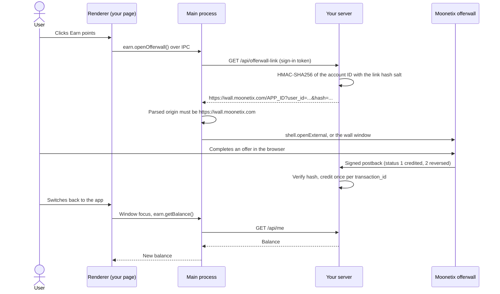

# Electron Offerwall

**Add a Moonetix offerwall to an Electron desktop app: your server signs the link, the main process opens it in the user's browser or in a locked-down window, and points change only from verified postbacks.**

[](https://github.com/moonetix/offerwall-electron/actions/workflows/ci.yml)
[](LICENSE)
[](https://docs.moonetix.com/offerwall-link)
[](https://moonetix.com/register?from=github-offerwall-electron)
[](https://moonetix.com/academy/integrations/electron-offerwall)
[](https://moonetix.com/industries/apps)

An Electron app in `app/` and a small Node.js server in `server/` for the [Moonetix](https://moonetix.com) offerwall. Moonetix is an affiliate network: your users earn your own points by completing offers, and you earn per completed offer. Electron ships its JavaScript to every user, so the app holds no key: it asks your server for a signed link and only reads the balance back.

> **Get your App ID and keys: sign up free at https://moonetix.com/register?from=github-offerwall-electron**

## Why it is built this way

1. **The renderer can do almost nothing.** Context isolation, the sandbox, no Node.js, a `script-src 'self'` policy, and a preload that exposes six narrow functions. The sign-in token, the API calls and `shell.openExternal` all stay in the main process, which checks the sender of every IPC message.
2. **Two ways to show the wall, both tested.** The default opens the user's browser with `shell.openExternal`. Set `OPEN_WALL_IN=window` for an in-app window with its own in-memory session, no preload, every permission denied, and every offer and off-wall link handed to the browser.
3. **Checked end to end.** A smoke test starts the real app against the real server, signs up, clicks Earn, and checks the exact signed link. In window mode it also checks new-tab links, off-site links, a 302 to another site, a `file:` link and a notification request against a local stand-in for the wall.

## How it fits together



## Quick start

You need Node.js 22.13 or later and an approved Moonetix app.

```bash
git clone https://github.com/moonetix/offerwall-electron.git
cd offerwall-electron
cp server/.env.example server/.env   # paste your App ID, link hash salt and postback secret key
npm run server                       # http://127.0.0.1:3000, leave it running
```

In a second terminal:

```bash
npm install                          # installs Electron 45.3.0
npm start                            # wall in the browser
OPEN_WALL_IN=window npm start        # wall in its own window
```

`EARN_API_URL` points the app at another server during development. For a release, set `API` at the top of `app/main.js` to your https server.

In the Moonetix dashboard:

1. Open Offerwalls, your offerwall, Integration, and copy the App ID and link hash salt into `server/.env`.
2. On the Postback page, copy the postback secret key into `server/.env` and save this postback URL:

```
https://YOUR_HOST/moonetix/postback?user={user_id}&tx={transaction_id}&event={event_id}&status={status}&reward={reward}&payout={payout}&offer={offer_name}&hash={hash}
```

| Variable | Where | Default | What it is |
| --- | --- | --- | --- |
| `MOONETIX_APP_ID` | `server/.env` | required | App ID from the Integration section. |
| `MOONETIX_LINK_SALT` | `server/.env` | required | Link hash salt. Server only. |
| `MOONETIX_POSTBACK_KEY` | `server/.env` | required | Postback secret key. Server only. |
| `MOONETIX_SUB1` | `server/.env` | `desktop` | Returned as `{sub1}`. Not signed, reports only. |
| `PORT` | `server/.env` | `3000` | Server port. |
| `HOST` | `server/.env` | `127.0.0.1` | Listen address. |
| `DATABASE_PATH` | `server/.env` | `./data.sqlite` | SQLite file, relative to `server/`. |
| `CURRENCY_NAME` | `server/.env` | `Coins` | Shown in the app. `.env.example` sets `Points`. |
| `SESSION_DAYS` | `server/.env` | `30` | Lifetime of a sign-in token on the server. |
| `EARN_API_URL` | app environment | `http://localhost:3000` | Development only. |
| `OPEN_WALL_IN` | app environment | `browser` | `browser` or `window`. |

## How it works

1. The user signs in or creates an account through the main process. Creating an account needs the "I am 16 or older" box. The main process keeps the sign-in token in memory; to keep users signed in, store it with `safeStorage.encryptStringAsync`.
2. On a click on Earn points, the renderer calls `earn.openOfferwall()`. The main process checks that the message came from the main window, asks your server for a fresh link, and checks that its parsed origin is exactly `https://wall.moonetix.com`.
3. The server signs the account ID of the signed-in user with the link hash salt and adds `sub1=desktop`. The app never sends a user ID.
4. The main process opens the link with `shell.openExternal`, or in the wall window.
5. Moonetix calls `GET /moonetix/postback`. The server checks the hash first, credits on status 1 once per `transaction_id`, takes back the stored amount on status 2, and answers 200 only after the change is stored.
6. When the app window gets focus again, the renderer reloads the balance.

**Browser or wall window.** Start with the browser. The user sees an address bar, keeps their own sign-ins, and offers that need an account sign-in run where they belong. The wall window keeps users in your app for browsing the wall, but offers still continue in the browser through the window-open handler. An `<iframe>` of the wall in your own page does not work: the wall only loads in frames on the https website registered for your app. Avoid the `<webview>` tag.

| File | Purpose |
| --- | --- |
| `app/main.js` | Windows, IPC handlers, API calls, `shell.openExternal`, wall window |
| `app/preload.js` | The `window.earn` bridge, one function per message |
| `app/index.html`, `renderer.js`, `styles.css` | Sign-in, balance, Earn button |
| `server/src/server.js` | HTTP routes |
| `server/src/moonetix.js` | Signed link, postback hash, amounts |
| `server/src/postback.js`, `store.js` | Postback handling and SQLite storage (`node:sqlite`) |
| `test/smoke.js` | Electron smoke test in both modes |

## Security notes

- The link hash salt and the postback secret key are read from environment variables on the server. Anyone can unpack an ASAR archive, so neither belongs in the app.
- The link is built on the server for the signed-in account only. The main process opens only URLs whose parsed origin is the wall; a `startsWith` check would let `https://wall.moonetix.com.example.net` through.
- The renderer never sees the sign-in token, never calls your API, and has no Node.js. Every IPC handler checks `event.sender`.
- The wall window has no preload, uses a separate in-memory session that denies every permission request, sends `window.open` and `target="_blank"` links to the browser, and stops `will-navigate` and `will-redirect` to other sites. Only `https:` URLs are handed to the operating system.
- The app never tells the server that an offer was completed. Points change only from the signed postback.
- The postback hash is checked with `crypto.timingSafeEqual` before anything else. Tampered or wrongly signed postbacks get 403.
- `transaction_id` is the primary key of the transactions table, so a retry cannot credit twice. A reversal subtracts the stored credited amount, only for a transaction credited to the same account.
- `payout`, `offer`, `event` and sub IDs are not signed. They are used for display, logs and reports, never for money.
- Reward users only for completed offers. Never gate features behind offers, and never reward ratings, reviews, installs or invites. Users must be 16 or older.

## Distribution rules

Read the current versions before you ship. In short: the Microsoft Store wants advertising that is clearly distinguishable and not the primary content, and a privacy statement that names the ad provider. The Mac App Store does not allow forcing users to rate, review or download other apps. Valve's [Advertising on Steam](https://partner.steamgames.com/doc/marketing/advertising) page asks developers not to reward players for engaging with ads, so leave the wall out of a Steam build. For your own download, describe the feature in your terms and say that rewards can be reversed.

## Test it

**Server**

```bash
npm test
```

No network and no Moonetix account needed. The tests check accounts and sign-in, that the link is signed for the signed-in account and matches links built by the Moonetix code for the same test keys, that no secret appears in any answer, and they replay real Moonetix postbacks (`server/test/fixtures/moonetix-vectors.json`): credit, retry, decimal rewards, another user's credit, reversal, repeated reversal, reversal of a never-credited `test_` transaction, unknown users, and tampered or wrongly signed postbacks.

**Against the running server**

With `npm run server` running and a test account created in the app, run [postback-tester](https://github.com/moonetix/postback-tester). It signs postbacks exactly like Moonetix and sends a credit and its retry, three kinds of reversal, four forged or unsigned requests and five parallel copies of one credit. It exits 1 if the handler gets any of them wrong.

```bash
export MOONETIX_POSTBACK_KEY=your-postback-secret-key   # same value as in server/.env
npx github:moonetix/postback-tester --preset moonetix \
  'http://127.0.0.1:3000/moonetix/postback?user={user_id}&tx={transaction_id}&event={event_id}&status={status}&reward={reward}&payout={payout}&offer={offer_name}&hash={hash}' --user 1
```

**App**

```bash
npm run test:smoke
npm run test:smoke -- --wall-window
```

The smoke test starts the server in memory and the real app, records `shell.openExternal` instead of opening a browser, and drives the page. It checks that the page has no `require` or `process`, that sign-up needs the 16+ box, that Earn passes the exact signed link for account `1`, and that a credited postback shows after the window gets focus. With `--wall-window` it serves a stand-in for the wall in the wall window's session and checks that new-tab, off-site and redirected links go to the browser, a `file:` link is dropped, links inside the wall stay in the window, and a notification request is denied. On a Linux machine without a display, run it with `xvfb-run -a`. CI runners also need `-- --no-sandbox`, as in `.github/workflows/ci.yml`.

**With Moonetix**

1. Start the app and create a test account. It gets user ID `1` on a fresh database.
2. In the dashboard, open Offerwalls, your offerwall, Integration. Under Integration status, use Check a link, then Test a link with user ID `1`. It must match the link your server returns.
3. Click Earn points from a normal home connection, not a VPN or cloud machine. The wall must open, not the Link not valid page.
4. Click **Send a test postback** with user ID `1` and status 1. You can also send one from the Postback page. Switch back to the app: the balance goes up once.
5. A status 2 test uses a new `test_` transaction ID that was never credited, so nothing changes. Every attempt is listed under Reports, Postbacks.
6. With the wall window, check on Windows, macOS and Linux that a real offer opens in the browser, not a second Electron window.

Desktop users see only desktop offers for their country, which can be fewer than on a phone.

## Common problems

| What you see | Why, and the fix |
| --- | --- |
| `node: .env: not found`, or `Missing environment variables: ...` from `npm run server` | Run `cp server/.env.example server/.env` and fill in the three Moonetix values. |
| The app says "The server is not reachable right now." | `npm run server` is not running, or `EARN_API_URL` (or `API` in `app/main.js`) points elsewhere. |
| The app says "Offers are not available right now." | `/api/offerwall-link` failed, or returned a URL whose origin is not `https://wall.moonetix.com`. Check the server log. |
| `error while loading shared libraries: libgtk-3.so.0` on Linux | Electron needs the desktop libraries. Install GTK 3 and NSS from your distribution, or run on a desktop machine. |
| The smoke test hangs or fails on a server | No display. Run it with `xvfb-run -a`, and add `-- --no-sandbox` in containers and CI. |
| Postback answers `200 unknown_user` or `200 ignored: unknown user` | The `user` value is not an account in your database (`test_user` from a default dashboard test, for example). Nothing is credited. |

## Learn more

- Guide: [How to Add an Offerwall to an Electron Desktop App](https://moonetix.com/academy/integrations/electron-offerwall)
- Guide: [How to promote a browser extension or desktop app](https://moonetix.com/academy/strategy/promote-browser-extension-software)
- Docs: [Offerwall link](https://docs.moonetix.com/offerwall-link), [Postbacks](https://docs.moonetix.com/postbacks), [Credits and reversals](https://docs.moonetix.com/credits-and-reversals), [Testing](https://docs.moonetix.com/testing)
- Moonetix for apps: [moonetix.com/industries/apps](https://moonetix.com/industries/apps)
- Free tools: [Offerwall link builder](https://moonetix.com/tools/offerwall-link-builder) and [Postback hash checker](https://moonetix.com/tools/postback-hash-checker)

## Get started

**Get your App ID and keys: sign up free at https://moonetix.com/register?from=github-offerwall-electron**

Every publisher application is reviewed by hand. Once you are approved, add your app, set your points name and rate, and paste the keys into `server/.env`.

## More Moonetix examples

**Start here**
- [awesome-offerwalls](https://github.com/moonetix/awesome-offerwalls): curated guides, tools and examples for offerwall publishers
- [offerwall-postback-handlers](https://github.com/moonetix/offerwall-postback-handlers): tested postback handlers in PHP, Node.js, Python and Java

**SDKs**
- [moonetix-android-sdk](https://github.com/moonetix/moonetix-android-sdk), [moonetix-ios-sdk](https://github.com/moonetix/moonetix-ios-sdk), [moonetix-flutter](https://github.com/moonetix/moonetix-flutter), [moonetix-react-native](https://github.com/moonetix/moonetix-react-native), [moonetix-unity](https://github.com/moonetix/moonetix-unity)

**Web frameworks and backends**
- [offerwall-nextjs-starter](https://github.com/moonetix/offerwall-nextjs-starter), [offerwall-react-vite](https://github.com/moonetix/offerwall-react-vite), [offerwall-vue-nuxt](https://github.com/moonetix/offerwall-vue-nuxt), [offerwall-express](https://github.com/moonetix/offerwall-express), [offerwall-laravel](https://github.com/moonetix/offerwall-laravel), [offerwall-django](https://github.com/moonetix/offerwall-django)
- [offerwall-firebase-functions](https://github.com/moonetix/offerwall-firebase-functions), [offerwall-supabase](https://github.com/moonetix/offerwall-supabase), [rewards-site-starter](https://github.com/moonetix/rewards-site-starter), [moonetix-offerwall-wordpress](https://github.com/moonetix/moonetix-offerwall-wordpress)

**Apps, games and communities**
- [offerwall-flutter-example](https://github.com/moonetix/offerwall-flutter-example), [offerwall-react-native-example](https://github.com/moonetix/offerwall-react-native-example), [offerwall-chrome-extension](https://github.com/moonetix/offerwall-chrome-extension)
- [offerwall-unity-example](https://github.com/moonetix/offerwall-unity-example), [offerwall-godot](https://github.com/moonetix/offerwall-godot), [offerwall-html5-game](https://github.com/moonetix/offerwall-html5-game)
- [telegram-mini-app-offerwall](https://github.com/moonetix/telegram-mini-app-offerwall), [discord-rewards-bot](https://github.com/moonetix/discord-rewards-bot)

**Tools and data**
- [postback-tester](https://github.com/moonetix/postback-tester): signed test postbacks that catch double credits, missed reversals and forged requests
- [signup-guard](https://github.com/moonetix/signup-guard), [datacenter-ip-ranges](https://github.com/moonetix/datacenter-ip-ranges), [offerwall-fraud-playbook](https://github.com/moonetix/offerwall-fraud-playbook): fake sign-ups, datacenter traffic and reward fraud
- [reward-economy-kit](https://github.com/moonetix/reward-economy-kit), [referral-engine](https://github.com/moonetix/referral-engine), [gamification-kit](https://github.com/moonetix/gamification-kit): points math, referrals and retention
- [affiliate-postback-macros](https://github.com/moonetix/affiliate-postback-macros), [country-tiers](https://github.com/moonetix/country-tiers): postback formats of other networks and country tiers for targeting

## License

MIT. See [LICENSE](LICENSE).
